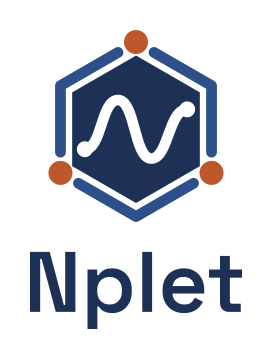

  <picture>
    <source media="(prefers-color-scheme: dark)" srcset="docs/assets/nplet/S2-accent.svg">
    <source media="(prefers-color-scheme: light)" srcset="docs/assets/nplet/S2-color.svg">
    
  </picture>

# An Agile-based framework and application for agent-driven work.

Nplet aims to give AI agents a prescribed process for planning, execution and retrospective learning. People set the direction and retain control of consequential decisions.

The framework and its core technology are in early development. We are building and testing them together.

## What we are building

Nplet has two connected parts:

- **An agentic Agile framework.** An operating model for planning, coordinating, checking and improving work performed by agents.
- **An orchestration application.** Software that will let people direct agents and coordinate their work through that framework.

The initial proof of concept (POC) uses a plugin to develop and test the approach. What we learn will shape the framework and future application.

## What we want to improve

- **Control and visibility:** Help people understand what agents are doing, where work is blocked and which decisions need attention.
- **Code quality:** Combine tightly scoped changes with clear acceptance criteria and independent checks.
- **Incremental delivery:** Deliver useful changes sooner while accounting for quality, human effort, cost and reliability.

These are goals for the POC. We still need evidence that the approach improves delivery against a fair comparison.

## The workflow

1. **Planning:** Turn a desired outcome into scoped work, dependencies and acceptance criteria. Establish what agents are authorized to do before execution.
2. **Execution:** Coordinate that work, expose progress and blockers, and check the result independently. Bring decisions that require human judgment back to people.
3. **Retrospective:** Review the outcome and the effort it required. Use what we learn to improve later work.

For example, a feature moves from an agreed outcome to a bounded change, independent review and a retrospective that informs the next plan.

## Current development

This repository contains published framework rules, role and profile templates, worked examples, and Python tooling for shared local task workspaces.

The workspace tooling includes integrations for Codex, Claude Code and Cursor. The complete orchestration application is still to be built. Coordinating agents across different runtimes remains a product goal.

## Contributor setup

The contributor guides cover macOS, Linux and native Windows. They describe the development environment, agent integrations and local checks.

1. [Set up your development workspace](docs/runtime/development.md#set-up-each-worktree).
2. [Configure your agent's task-workspace integration](docs/runtime/host-hooks.md#setup-and-bootstrap).
3. [Use the shared task workspace](docs/runtime/task-workspace-usage.md#usage).

Follow the [contributor workflow](docs/runtime/contributor-workflow.md) for repository changes. Submit changes through a pull request for human review.

## Explore the project

- [Organization and teams](src/nplet/resources/organization/team-map.md)
- [Role and profile definitions](src/nplet/resources/templates/definition-format.md)
- [Documentation index](docs/README.md)

## License

This repository uses the [PolyForm Noncommercial License 1.0.0](LICENSE).
